# User Requirements Document (URD) — Customer 360 Identity Resolution

> **Public portfolio sample.** All organisation names, system names, metrics and identifiers have been removed or generalised. This document describes a reference design, not any production system.

---

## Document control

| Field | Value |
|---|---|
| Document type | User Requirements Document (URD) |
| Domain | Customer Data Platform — Identity Resolution / Customer 360 |
| Standard | BABOK-aligned (requirements, business rules, acceptance criteria, traceability) |
| Status | Sample / showcase |
| Version | 1.0 (generic) |
| Author role | Business Analyst |

**Revision legend:** [A] Add · [U] Update · [D] Delete

---

## 1. Introduction

### 1.1 Purpose
This URD specifies the business and data requirements for a **Customer 360** capability that unifies fragmented customer records — scattered across multiple legacy source systems — into a single, trustworthy view **per real-world entity** (a person or an organisation), while preserving every source record for traceability.

The document is the input for downstream solution design, test planning, and UAT.

### 1.2 Scope

**In scope**
- A conceptual/logical data model for identity resolution (source → link → unified).
- Matching and reconciliation rules for individuals (B2C) and organisations (B2B).
- A search-and-retrieve experience that returns the complete entity regardless of the search term.
- Role-based field-level data masking.
- Exception and edge-case handling.

**Out of scope**
- Physical database design, infrastructure sizing, ingestion pipelines.
- Downstream AI/segmentation/activation (consumes the unified profile; not defined here).
- Source-system data-entry rules (governed by each source).

### 1.3 Intended audience
Product Owner, Business Sponsors, Data/Technical Architects, Developers, QA, and reviewers evaluating the design.

---

## 2. Business context

### 2.1 Problem statement
Customer information lives in several independent legacy systems (e.g. CRM, billing, service-request, provisioning). Each system holds its own copy; none is authoritative. Historically the data is keyed **by contract**, not **by customer**, so a single person holding three contracts is counted as three different customers. Every interaction therefore starts with manual cross-checking, reporting is unreliable, and no automation (including AI) can be trusted on a foundation the front line itself does not believe.

### 2.2 Business goal
Make the data **trustworthy enough that a human or an automated agent can act on it immediately**, without re-verifying — by shifting the axis of identity from *contract* to *customer*, and by making every unified view traceable back to its source.

### 2.3 Success measures (qualitative)
- Lookup returns the complete entity in a single step.
- One real person/organisation resolves to exactly one unified profile (subject to review thresholds).
- Any incorrect merge is reversible without data loss.
- Front-line trust in the data increases (measured via operational time-per-case and self-reported confidence).

> Quantitative targets are set per deployment and deliberately omitted from this public sample.

---

## 3. Stakeholders

| Stakeholder | Interest |
|---|---|
| Business Sponsor / PO | Business value, prioritisation, sign-off |
| Front-line users (support, field, sales) | Fast, correct single view of the customer |
| Data Architect | Identity-resolution ruleset, data model integrity |
| Technical Architect | Integration, performance, real-time vs batch |
| Compliance / Legal / Data Protection | Lawful use, purpose limitation, masking |
| QA | Testability of rules and edge cases |

---

## 4. Glossary

| Term | Meaning |
|---|---|
| Source record | A raw record as received from one source system; grain = one contract/profile. Never overwritten. |
| Unified Individual | A resolved person, keyed by a national identity number. |
| Unified Account | A resolved organisation, keyed by a business tax ID. |
| Identity Link | A bridge row connecting one source record to one unified record. Enables un-merge. |
| Contact Point | A phone, email, or address. Kept in full, never reconciled away. |
| Party Identification | A separately stored identity document (national ID / tax ID) used as a match key. |
| Match method | How values are transformed before comparison (exact → fuzzy). |
| Reconciliation rule | How one display value is chosen for a unified field. Produces a label, not a source of truth. |
| Consolidation rate | 1 − (unified profiles / source profiles). |
| Candidate | A tentative match (from fuzzy logic) awaiting human review; never auto-merged. |
| Scheduled match | Periodic batch run; all match methods available. |
| Real-time match | Sub-second lookup; restricted to exact / exact-normalized only. |

---

## 5. Solution overview — the three-layer principle

The design follows an identity-resolution pattern (as used by leading CDP platforms) built on **three layers** and one non-negotiable principle: **there is no "golden record".** The unified profile is a *label* that points back to the sources; it is not a new authoritative copy.

```
Layer 1 — SOURCE  : raw records, one row per contract/profile. NEVER overwritten.
Layer 2 — LINK    : bridge rows (source_record_id → unified_record_id). Reversible.
Layer 3 — UNIFIED : unified_individual (national_id) + unified_account (tax_id).
```

Design principles:
- **P1 — Non-destructive.** Source data is never changed or deleted; unification only references it.
- **P2 — Reversible.** An incorrect merge is undone by cutting a link row; the source is intact. (The "undo button".)
- **P3 — Two entities, not one.** People and organisations are separate unified types, linked — never merged into one axis.
- **P4 — Keep all contact points.** Multiple phones/emails/addresses are all retained; selection happens at activation time, not at merge time.
- **P5 — The displayed value is a label.** Reconciliation chooses what to show; the real value per use case is fetched via the link back to source.

---

## 6. Conceptual data model

### 6.1 Entities

| Layer | Entity | Key / grain | Purpose |
|---|---|---|---|
| Source | Source Individual | source_record_id | Raw person record (incl. national_id). |
| Source | Source Account | source_record_id | Raw organisation record (incl. tax_id). |
| Source | Source Party Identification | source_record_id | Raw identity document, typed national_id / tax_id. |
| Source | Source Contact Point (Phone / Email / Address) | source_record_id | Raw contact points. |
| Link | *_Identity Link (one per unified type) | link_id | Bridge: source_record_id → unified_record_id, + match_method. |
| Unified | Unified Individual | unified_record_id (national_id) | Resolved person. |
| Unified | Unified Account | unified_record_id (tax_id) | Resolved organisation. |
| Unified | Unified Party Identification | unified_record_id | Resolves to individual **or** account by identification_type. |
| Unified | Unified Contact Point (Phone / Email / Address) | unified_record_id | All unique contact points, owned by individual or account. |
| Unified | Account–Contact Relationship | acr_id | Junction: 1 account ↔ N individuals ↔ N contracts, with role. |
| Anchor | Contract | contract_id | Service anchor; hangs on the correct layer (individual and/or account). |

### 6.2 Key relationships
- Each Link row: `source_record_id → unified_record_id` (plus the match rule/method used).
- `unified_party_identification`: `identification_type = national_id → resolved_individual_id`; `identification_type = tax_id → resolved_account_id`.
- `account_contact_relationship` connects a person to an organisation with a `role` (signer / contact / owner).
- A contract may reference both a unified individual (signer) and a unified account (owner).

*(A generic logical ERD is provided in Appendix A.)*

---

## 7. Matching & reconciliation design

### 7.1 Match methods (five tiers)
Selected **per field**, trading precision against consolidation:

| Method | Use for |
|---|---|
| Exact | Identity keys (national_id, tax_id) — character-for-character. |
| Exact Normalized | Phone / email — ignore case, spacing, punctuation. |
| Fuzzy – High precision | Names with minor typos; prefer missing a match over a wrong merge. |
| Fuzzy – Medium | Moderate variance. |
| Fuzzy – Low | Aggressive; high consolidation, high risk; requires human review. |

Tuning: more **rules** raise consolidation; more **criteria** per rule lower it.

### 7.2 Mandatory rules
- **Match-on-blank OFF** for identity keys: an empty/null/placeholder key must never match.
- **Identity keys use Exact + Source Priority** so the key is stable across runs.
- Fuzzy matches on non-key fields create **candidates**, never auto-merges.

### 7.3 Reconciliation rules
One display value per unified field, chosen by:

| Rule | Behaviour |
|---|---|
| Source Priority | Prefer a ranked source. **Mandatory for ID fields** (stability). |
| Last Updated | Take the most recently updated value. |
| Most Frequent | Take the most frequent value. |

Set a default per object; override per field. Reconciliation **does not** pick a "best" value — it summarises. The authoritative value is fetched via the link, per use case.

### 7.4 Scheduled vs real-time
- **Scheduled (batch):** periodic; full set of match methods; deeper consolidation.
- **Real-time:** sub-second; **restricted to Exact (Exact Normalized for phone/email)**, regardless of the scheduled method. Consequence: real-time may under-merge versus batch; the two can diverge within the lag window. Reconciliation rules are identical in both modes.

---

## 8. Functional requirements

| ID | Requirement |
|---|---|
| FR-01 | Users can search by any identifier (name, phone, contract number, national ID, tax ID) from a single search box. |
| FR-02 | Results that belong to the same unified entity are **grouped** under one parent row, showing the count of child contracts. |
| FR-03 | Selecting a parent navigates to the entity (Customer) view; selecting a child navigates to the Contract view. |
| FR-04 | A unified Individual view shows: identity, segments, loyalty, contact points, linked organisations, and all contracts. |
| FR-05 | A unified Account view shows: organisation identity, linked individuals (with roles), and all contracts. |
| FR-06 | Role-based masking hides sensitive fields (phone, address, identity numbers) per the permission matrix. |
| FR-07 | Every unified field can be traced back to its contributing source record(s). |
| FR-08 | Reviewers can inspect, approve, or reject candidate matches. |
| FR-09 | Authorised users can un-merge an incorrect merge; the source remains intact. |

---

## 9. Business rules

| ID | Rule |
|---|---|
| BR-01 | Source records are immutable; unification only references them. |
| BR-02 | A person resolves to exactly one Unified Individual via national_id (Exact). |
| BR-03 | An organisation resolves to exactly one Unified Account via tax_id (Exact). |
| BR-04 | A person and an organisation are never merged into one entity; they are linked via Account–Contact Relationship. |
| BR-05 | Organisations owned/represented by the same person are **not** merged; each stays a separate Unified Account. |
| BR-06 | Empty/placeholder identity keys never participate in matching (match-on-blank OFF). |
| BR-07 | Contact points are retained in full; reconciliation applies only to their descriptive attributes (e.g. "personal" vs "business"), never to drop a contact point. |
| BR-08 | ID fields use Source Priority reconciliation to remain stable across runs. |
| BR-09 | A single unified profile may not absorb more than a configurable maximum number of source records; exceeding it halts the merge and raises an alert. |
| BR-10 | Hierarchical / dependent-unit tax codes (a branch code derived from a parent tax ID) must be normalised to the parent organisation; branches are sub-units, not independent accounts. |
| BR-11 | Where a sole-proprietor / household business is identified by the owner's personal identity number, business activity must remain distinguishable from the owner's personal activity (do not collapse the two), even though they share a key. |
| BR-12 | When an identity scheme changes (e.g. a legacy tax ID superseded by the national ID), old and new identifiers are mapped so the entity is not split; the mapping is maintained via the link layer and is reversible. |

---

## 10. Acceptance criteria

### Happy path

**AC-01 — Any search term returns the whole entity**
- Given a person holds three contracts
- When a user searches by any of: name, phone, contract number, national ID
- Then all three contracts appear grouped under one parent row, with the count displayed
- And every row resolves to the same unified_record_id.

**AC-02 — Source-to-unified traceability**
- Given a unified field (e.g. display name) chosen by reconciliation
- When a user requests its origin
- Then the system returns the contributing source record(s) via the link layer.

### Exception / edge cases

**AC-03 — Blank or junk identity key is not merged**
- Given a source record whose national_id (or tax_id) is empty, null, or a placeholder (e.g. all-zeros)
- When the ruleset runs
- Then the record is **not** merged via that key (match-on-blank OFF)
- And if it still matches on a secondary fuzzy rule, it is placed in **candidate** state for human review — never auto-merged
- And no single cluster exceeds the configurable maximum; on reaching it, the merge halts and raises an alert.

**AC-04 — Real-time no-match returns a split view, not a guess**
- Given a real-time lookup whose input is not an Exact (or Exact-Normalized) match to any unified profile
- When real-time matching runs
- Then no guessed unified profile is returned; the record is shown as **not-yet-unified**
- And the record is queued for the next scheduled run
- And the UI notes that real-time figures may differ from batch within the lag window.

**AC-05 — Un-merge restores without data loss**
- Given two source records were incorrectly merged into one unified profile
- When a reviewer un-merges them
- Then only the link rows change; both source records remain intact and fully traceable
- And lineage of the former merge is retained for audit.

**AC-06 — One owner, many organisations**
- Given one person owns/represents two separate organisations (two distinct tax IDs)
- When unification runs
- Then there is exactly one Unified Individual and two Unified Accounts
- And the person is connected to each account via a distinct Account–Contact Relationship row with its own role
- And the two accounts are never merged with each other.

**AC-07 — Dependent-unit tax code normalisation**
- Given an organisation with a parent tax ID and multiple branches carrying derived (dependent-unit) tax codes
- When unification runs
- Then branches are grouped under the parent Unified Account as sub-units
- And each branch is not treated as an independent organisation.

**AC-08 — Shared-key sole-proprietor / household business**
- Given a household/sole-proprietor business identified by the owner's personal identity number
- When unification runs
- Then the business activity is kept distinguishable from the owner's personal activity (customer type governs placement)
- And if classification is ambiguous, the record is routed to **candidate** for review rather than auto-merged.

**AC-09 — Identifier supersession (scheme change)**
- Given an entity holds both a legacy identifier and a new identifier after an identity-scheme change
- When unification runs
- Then old and new identifiers are mapped to one unified profile (not two)
- And the mapping is maintained via the link layer and is reversible.

---

## 11. Edge-case & risk-flag catalogue

Beyond the ACs, the following conditions are detected and routed for review (flags, not automated judgements; subject to purpose limitation and data-protection law):

| Flag | Condition | Signal |
|---|---|---|
| EC-01 Duplicate skip | Contact points sharing the same record/source/object/qualifier | First is kept arbitrarily; data grooming required. |
| EC-02 Orphaned contact point | Contact point with no primary record | Dropped from unification; source needs repair. |
| EC-03 Oversized input | Input record exceeds the size limit | Skipped; investigate formatting. |
| EC-04 Truncated match values | Combined matched value length exceeds the limit | Values truncated → possible mismatch. |
| EC-05 Runaway cluster | A cluster approaches the max-per-profile ceiling | Almost always match-on-blank or placeholder data; split + alert. |
| EC-06 Re-registration after debt | Same unified individual with a terminated/unpaid contract and a new active contract | Possible debt-dodge via re-registration. |
| EC-07 Illegal multiplicity | One personal ID linked to more household businesses than the jurisdiction allows | Data error or borrowed-identity signal. |
| EC-08 Many entities, one address | Many "individual" contracts of different IDs at one commercial address with business-like usage | Possible unregistered business. |
| EC-09 Identity reuse | One phone/email mapped to many distinct individuals | Possible fabricated/borrowed data. |
| EC-10 Shell pattern | An account sharing all contact points with one individual and no independent activity | Possible shell entity. |

> These are **risk flags for human review within a lawful, scoped purpose**, not accusations and not automated blocking.

---

## 12. Non-functional requirements

| ID | Requirement |
|---|---|
| NFR-01 | Real-time lookup returns within sub-second latency for the first view. |
| NFR-02 | Field-level masking is enforced by role on every view. |
| NFR-03 | Non-real-time data may carry a defined freshness lag; the lag is disclosed to users. |
| NFR-04 | The ruleset job runs at least once per day and is skipped when nothing changed. |
| NFR-05 | All merges/un-merges are auditable with lineage retained. |

---

## 13. Assumptions, constraints, risks

**Assumptions**
- Source-to-platform ingestion and mapping are complete and validated before unification.
- National identity numbers and business tax IDs are available for the majority of records.

**Constraints**
- Real-time matching is exact-only by platform design.
- Satellite tools must continue operating; the solution augments, it does not replace.

**Risks & mitigations**
- *Over-merge from dirty keys* → match-on-blank OFF, cluster ceiling, candidate review (BR-06, BR-09, AC-03).
- *Under-merge in real time* → disclosed lag + scheduled reconciliation (AC-04).
- *Split identity on scheme change* → identifier mapping (BR-12, AC-09).
- *Clean data first, AI later* — automation is layered only on a trusted, reversible foundation.

---

## 14. Open questions / out of scope
- Exact cluster ceiling and freshness-lag values are deployment-specific.
- Legal basis and retention for risk flags must be confirmed with Compliance before activation.

---

## 15. Traceability (sample)

| Requirement | Business rule(s) | Acceptance criteria |
|---|---|---|
| FR-01 / FR-02 | BR-02, BR-03 | AC-01 |
| FR-07 | BR-01 | AC-02, AC-05 |
| FR-08 | BR-06 | AC-03 |
| Real-time behaviour | — | AC-04 |
| FR-09 | BR-01, BR-05 | AC-05, AC-06 |
| B2B structure | BR-04, BR-05, BR-10 | AC-06, AC-07 |
| Jurisdictional keys | BR-11, BR-12 | AC-08, AC-09 |

---

## Appendix A — Logical ERD (Mermaid, renders on GitHub)

> GitHub renders the diagram below automatically. (Code-fence languages like `dbml` only show as text — use Mermaid when you need a rendered picture in a README/GitHub.)

```mermaid
erDiagram
  SOURCE_INDIVIDUAL        ||--o{ INDIVIDUAL_IDENTITY_LINK : "source"
  UNIFIED_INDIVIDUAL       ||--o{ INDIVIDUAL_IDENTITY_LINK : "resolves to"
  SOURCE_ACCOUNT           ||--o{ ACCOUNT_IDENTITY_LINK : "source"
  UNIFIED_ACCOUNT          ||--o{ ACCOUNT_IDENTITY_LINK : "resolves to"
  UNIFIED_INDIVIDUAL       ||--o{ UNIFIED_PARTY_IDENTIFICATION : "national_id"
  UNIFIED_ACCOUNT          ||--o{ UNIFIED_PARTY_IDENTIFICATION : "tax_id"
  UNIFIED_INDIVIDUAL       ||--o{ UNIFIED_CONTACT_POINT : "owns"
  UNIFIED_ACCOUNT          ||--o{ UNIFIED_CONTACT_POINT : "owns"
  UNIFIED_ACCOUNT          ||--o{ ACCOUNT_CONTACT_RELATIONSHIP : "has"
  UNIFIED_INDIVIDUAL       ||--o{ ACCOUNT_CONTACT_RELATIONSHIP : "member of"
  UNIFIED_ACCOUNT          ||--o{ CONTRACT : "owns (B2B)"
  UNIFIED_INDIVIDUAL       ||--o{ CONTRACT : "signs (B2C/B2B)"

  SOURCE_INDIVIDUAL {
    varchar source_record_id PK
    varchar data_source_id
    varchar full_name
    varchar national_id "Exact, match-on-blank OFF"
  }
  SOURCE_ACCOUNT {
    varchar source_record_id PK
    varchar account_name
    varchar tax_id "Exact"
  }
  INDIVIDUAL_IDENTITY_LINK {
    varchar link_id PK
    varchar source_record_id FK
    varchar unified_record_id FK
    varchar match_method
  }
  ACCOUNT_IDENTITY_LINK {
    varchar link_id PK
    varchar source_record_id FK
    varchar unified_record_id FK
    varchar match_method
  }
  UNIFIED_INDIVIDUAL {
    varchar unified_record_id PK "national_id, Exact + source_priority"
    varchar full_name "label only (recon)"
  }
  UNIFIED_ACCOUNT {
    varchar unified_record_id PK "tax_id, Exact + source_priority"
    varchar account_name
    varchar status "unified | candidate"
  }
  UNIFIED_PARTY_IDENTIFICATION {
    varchar unified_record_id PK
    varchar identification_type "national_id | tax_id"
    varchar resolved_individual_id FK
    varchar resolved_account_id FK
  }
  UNIFIED_CONTACT_POINT {
    varchar unified_record_id PK
    varchar individual_id FK
    varchar account_id FK
    varchar kind "phone | email | address"
    boolean is_primary
  }
  ACCOUNT_CONTACT_RELATIONSHIP {
    varchar acr_id PK
    varchar account_id FK
    varchar individual_id FK
    varchar role "signer | contact | owner"
  }
  CONTRACT {
    varchar contract_id PK
    varchar source_record_id FK
    varchar account_id FK
    varchar individual_id FK
    varchar status
  }
```



---

## Appendix B — Logical ERD (DBML, paste into dbdiagram.io)

```dbml
// Source -> Identity Link -> Unified (Individual + Account)
// Generic names; no internal system, schema or record values.

Table source_individual {
  source_record_id varchar [pk]
  data_source_id varchar
  full_name varchar
  national_id varchar [note: 'match key — Exact, match-on-blank OFF']
}
Table source_account {
  source_record_id varchar [pk]
  data_source_id varchar
  account_name varchar
  tax_id varchar [note: 'match key — Exact']
}
Table source_party_identification {
  source_record_id varchar [pk]
  identification_type varchar [note: 'national_id | tax_id']
  identification_number varchar
}
Table source_contact_point_phone  { source_record_id varchar [pk], phone varchar }
Table source_contact_point_email  { source_record_id varchar [pk], email varchar }
Table source_contact_point_address{ source_record_id varchar [pk], address varchar, address_kind varchar }

Table individual_identity_link {
  link_id varchar [pk]
  source_record_id varchar
  unified_record_id varchar
  match_method varchar
}
Table account_identity_link {
  link_id varchar [pk]
  source_record_id varchar
  unified_record_id varchar
  match_method varchar
}

Table unified_individual {
  unified_record_id varchar [pk, note: 'national_id — Exact + source_priority']
  full_name varchar [note: 'recon: last_updated (label only)']
  reconciliation_rule_default varchar
}
Table unified_account {
  unified_record_id varchar [pk, note: 'tax_id — Exact + source_priority']
  account_name varchar [note: 'recon: source_priority']
  status varchar [note: 'unified | candidate']
}
Table unified_party_identification {
  unified_record_id varchar [pk]
  identification_type varchar
  resolved_individual_id varchar [note: 'when national_id']
  resolved_account_id varchar [note: 'when tax_id']
}
Table unified_contact_point_phone  { unified_record_id varchar [pk], individual_id varchar, account_id varchar, is_primary boolean }
Table unified_contact_point_email  { unified_record_id varchar [pk], individual_id varchar, account_id varchar, is_primary boolean }
Table unified_contact_point_address{ unified_record_id varchar [pk], individual_id varchar, account_id varchar, address_kind varchar }

Table account_contact_relationship {
  acr_id varchar [pk]
  account_id varchar
  individual_id varchar
  role varchar [note: 'signer | contact | owner']
}
Table contract {
  contract_id varchar [pk]
  source_record_id varchar
  account_id varchar
  individual_id varchar
  status varchar
}

Ref: individual_identity_link.source_record_id > source_individual.source_record_id
Ref: individual_identity_link.unified_record_id > unified_individual.unified_record_id
Ref: account_identity_link.source_record_id > source_account.source_record_id
Ref: account_identity_link.unified_record_id > unified_account.unified_record_id
Ref: unified_party_identification.resolved_individual_id > unified_individual.unified_record_id
Ref: unified_party_identification.resolved_account_id > unified_account.unified_record_id
Ref: account_contact_relationship.account_id > unified_account.unified_record_id
Ref: account_contact_relationship.individual_id > unified_individual.unified_record_id
Ref: contract.account_id > unified_account.unified_record_id
Ref: contract.individual_id > unified_individual.unified_record_id
```

*End of document.*
